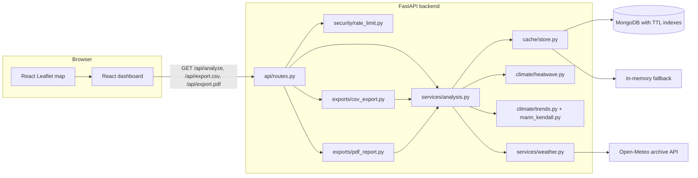

# Climate Lens architecture

## Components

| Layer | Path | Responsibility |
| --- | --- | --- |
| Pure climate logic | `backend/app/climate/` | Calendar alignment, percentile threshold, event detection, annual attribution, regression, rolling means, Mann-Kendall, insight text. No I/O and no framework imports. |
| Data ingestion | `backend/app/services/weather.py` | HTTPX client for Open-Meteo: request building, bounded retries, response validation, unit checks, multi-point averaging, source metadata. |
| Orchestration | `backend/app/services/analysis.py` | Cache lookups, fetching only the needed date ranges, running the climate pipeline, and assembling the Pydantic response. |
| Persistence | `backend/app/cache/store.py` | `MongoCache` (TTL indexes, `observations` and `analyses` collections) and `MemoryCache` (LRU + TTL) behind one interface. |
| HTTP | `backend/app/api/routes.py`, `backend/app/main.py` | Query validation via `AnalysisQuery`, rate limiting, CORS, uniform error JSON, CSV/PDF responses. |
| Reports | `backend/app/exports/` | CSV with formula-injection protection; ReportLab PDF with charts, repeated table headers, and page numbers. |
| Frontend | `frontend/src/` | Selection state, map, controls, charts, statistics, data tables, export downloads. |

## Request flow for `/api/analyze`

1. FastAPI parses the query into `AnalysisQuery`. Pydantic validation covers coordinate ranges, point-or-box exclusivity, box size, year bounds and span, reference period, supported hazard, and label sanitising. Invalid input returns `422` without contacting the provider.
2. The per-IP sliding-window rate limiter checks the `analyze`, `export` or `geocode` bucket and returns `429` with `Retry-After` when the limit is exceeded. The client IP comes from Cloudflare's `CF-Connecting-IP` (`CLIENT_IP_HEADER`), falling back to a fixed position counted from the right of `X-Forwarded-For` (`TRUSTED_PROXY_HOPS`); IPv6 clients are keyed by /64. With MongoDB configured, hits are recorded in the shared `rate_limits` collection by one atomic update; every response carries `X-RateLimit-*` headers.
3. `AnalysisService` derives the sample points: the point itself for point queries, or up to a 2x2 grid of cell centres for a box. It then builds the analysis cache key from the points, years, hazard, percentile, minimum duration, baseline mode and reference years, completeness rule, label, and `ALGORITHM_VERSION`.
4. **Analysis cache hit:** the stored document is validated against the response model. It is only returned if its `algorithm_version` matches the current one.
5. **Cache miss:** observations are fetched per date range.
   - Analysis and reference ranges that overlap or touch are merged into one request; disjoint ranges are fetched separately.
   - Each range is stored in the `observations` collection, which has a longer TTL.
6. The climate pipeline runs: `build_daily_series`, then `percentile_threshold`, `detect_events`, `annual_indicators`, regression and Mann-Kendall for each indicator, and finally the insights.
7. The response is stored in the `analyses` collection and returned.

`/api/export.csv` and `/api/export.pdf` call the same `AnalysisService.analyze`, so all three outputs share one computation and usually one cache entry. `backend/tests/test_api.py::test_dashboard_csv_pdf_agree` checks that they agree.

## Frontend state

- `Selection` holds a point or box location, label, years, hazard, baseline, and reference years. It is validated on the client with the same limits as the server.
- `useAnalysis` aborts any in-flight request when a new one starts, and a request counter discards late responses.
- Results remember the query parameters that produced them. If the selection changes afterwards, a warning banner shows which region and period the results describe. Exports always use the parameters of the displayed results.
- Typed coordinates are committed to the selection after a 500 ms pause. Analyses only run when the user clicks **Run analysis**, apart from one initial default run on page load.

## Caching and scaling notes

- MongoDB TTL indexes (`expires_at`, `expireAfterSeconds: 0`) remove expired documents. Reads also check `expires_at`, because the TTL monitor runs only about once a minute.
- If MongoDB is unreachable at startup, the app falls back to the in-memory cache and `/api/health` reports this. If MongoDB fails at runtime, the operation is logged, treated as a cache miss, and health reports `healthy: false`.
- With MongoDB, a background thread started from the FastAPI `lifespan` pre-warms the preset cities' default analyses for every hazard (`services/prewarm.py`). It skips anything already cached, spaces provider fetches 120 s apart, stops at the first quota error, and reports progress in `/api/health` under `prewarm`.
- Open-ocean points are rejected during request validation using a precomputed 0.1° near-land grid (`services/land.py`, `data/land_mask.npz`), before any cache or provider call.
- The in-memory cache is **per process**. The rate limiter is shared through MongoDB when it is configured, so several instances, overlapping deploys and restarts all see the same counts; without MongoDB, or if a MongoDB call fails, it falls back to per-process counters. Redis would give lower latency for both (`SETEX` for the cache, a sorted-set sliding window for the limiter).
